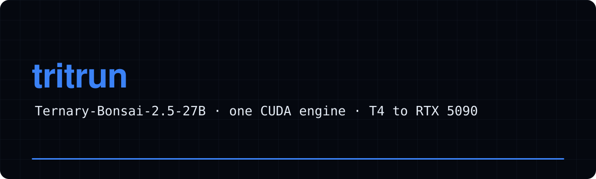
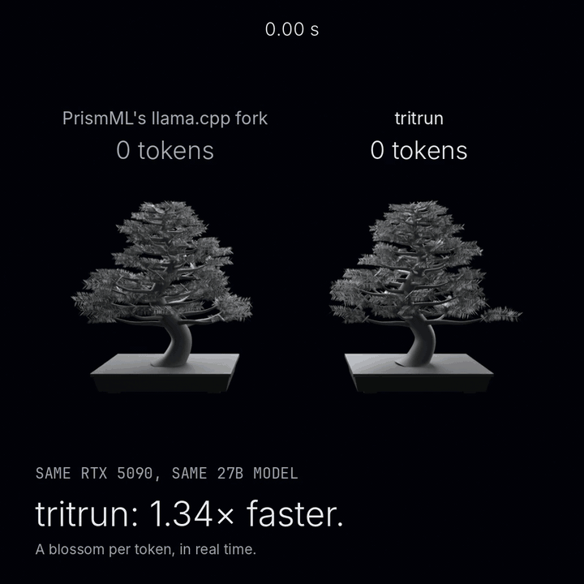
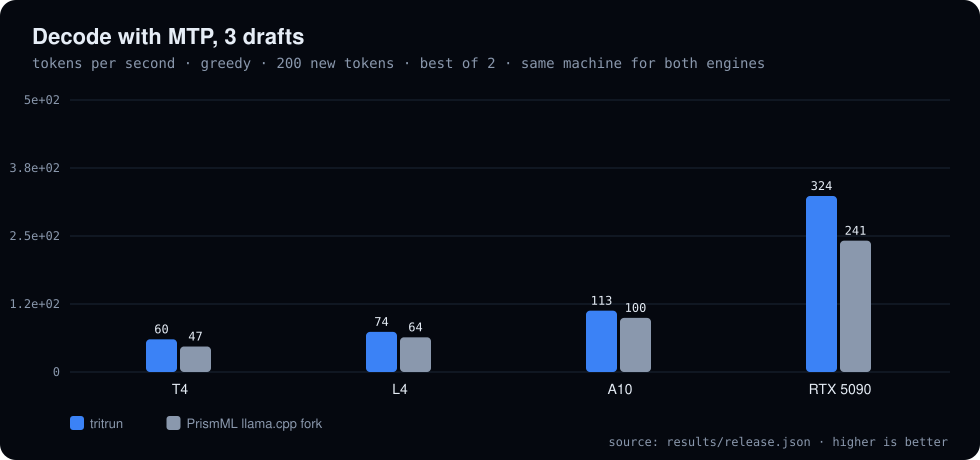
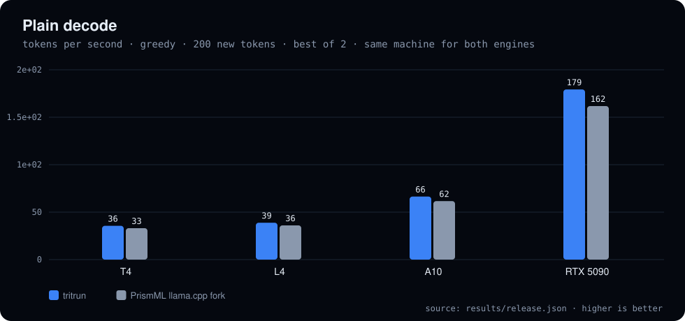
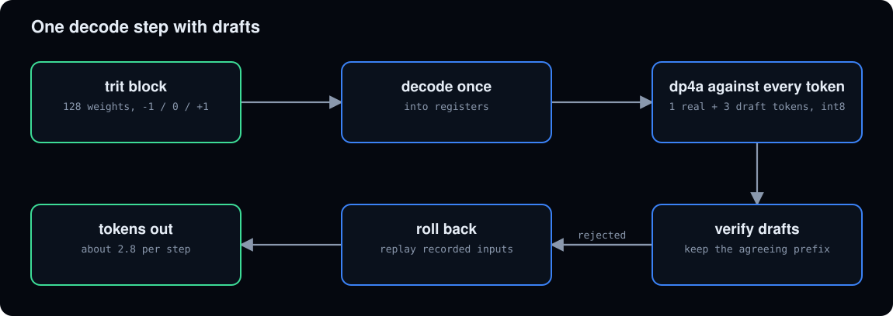
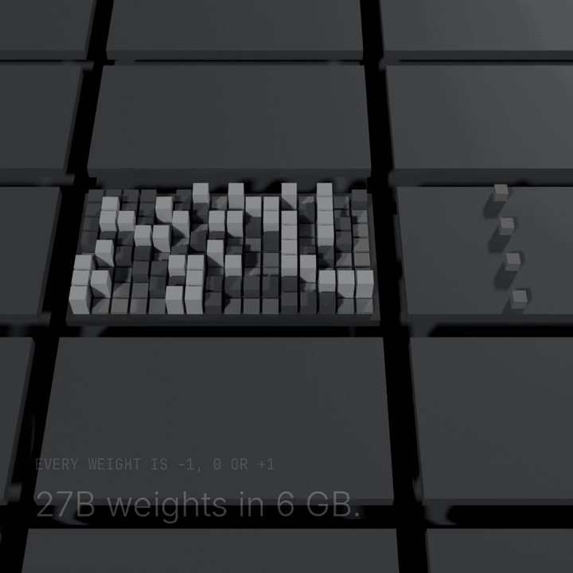

<div align="center">



# 🌳 tritrun

**A Ternary Bonsai engine, 1.34× faster than PrismML's.**

  

[📈 Results](#results) · [⏩ How fast is prefill?](#prefill) · [🧩 How it works](#how-it-works) · [🎯 Accuracy](#accuracy) · [🚀 Quick start](#quick-start) · [⚠️ Honest caveats](#caveats) · [🗺️ Repo map](#repo-map)

</div>

---

tritrun is a standalone CUDA inference engine for PrismML's
[Ternary-Bonsai-2.5-27B](https://huggingface.co/prism-ml/Ternary-Bonsai-2.5-27B-GGUF) in its PTQ1_0 GGUF: weights of -1, 0 and +1, about 6 GB in all, so a
27B model fits on a 16 GB T4. It is aimed at the small and mid-range cards where decode is limited by memory bandwidth, and it
is compared with PrismML's own llama.cpp fork, the only other engine that runs this file on NVIDIA, at the fork's best settings.

[](assets/launch.mp4)

*Launch video (17 s, with sound). Click to play. The 128-weight block, the 64 layers and the two decode rates are the real ones, and the race runs in real time at each engine's average rate. The trit values, the token widths and the pace of the first two shots are illustrative. Made with [`media/film.py`](media/film.py).*

<p align="center"></p>

*Decode with 3 MTP drafts on an RTX 5090, in real time at each engine's measured average rate.*

<a id="results"></a>

## 📈 Results

The fork is `prism-b12178-03ec600` with flash attention, FP16 KV, 4096 context and one slot. Each fork figure is its best
setting among those tried: `-ub 512` and `-ub 64`, and MTP with 3 drafts at cut-off 0.1 and 0. Both engines ran in the same
container on the same GPU with the same prompt token ids. Decode is 4 short prompts, greedy, 200 new tokens, the better of 2
repetitions. VRAM is peak `nvidia-smi` memory against the fork at `-ub 64`, its leanest setting.

**Decode, tokens per second (higher is better)**

| GPU | Plain, fork | Plain, tritrun | Gain | MTP, fork | MTP, tritrun | Gain | MTP VRAM MiB, fork | MTP VRAM MiB, tritrun |
| :--- | ---: | ---: | ---: | ---: | ---: | ---: | ---: | ---: |
| T4 | 33.1 | 35.6 | +8% | 46.8 | 60.1 | +28% | 6,738 | 6,396 |
| L4 | 36.0 | 38.8 | +8% | 63.7 | 73.7 | +16% | 6,853 | 6,487 |
| A10 | 61.6 | 66.4 | +8% | 99.5 | 112.7 | +13% | 6,899 | 6,525 |
| RTX 5090 | 161.8 | 179.3 | +11% | 241.4 | 323.6 | +34% | 7,284 | 6,790 |

<sub>Source: `results/release.json`</sub>

<p align="center"></p>

<p align="center"></p>

Full conditions, machine-to-machine spread and the logs behind each figure: [docs/benchmarks.md](docs/benchmarks.md).

<a id="prefill"></a>

## ⏩ How fast is prefill?

Real text, best of 3. Ours is the wall time of the whole prefill plus the first token, and the fork's is its own
`prompt_per_second` at its default batch size. The first generated token agreed in every case.

**Prefill, tokens per second (higher is better)**

| GPU | 64, fork | 64, tritrun | 512, fork | 512, tritrun | 2,048, fork | 2,048, tritrun |
| :--- | ---: | ---: | ---: | ---: | ---: | ---: |
| T4 | 208 | 352 | 331 | 412 | 341 | 403 |
| L4 | 367 | 745 | 741 | 827 | 788 | 811 |
| A10 | 500 | 998 | 913 | 994 | 951 | 966 |
| RTX 5090 | 553 | 3,461 | 2,899 | 4,043 | 3,174 | 3,531 |

<sub>Source: `results/release.json`</sub>

- ✅ **Decode:** faster on every card, 8% to 11% plain and 13% to 34% with MTP, where one read of the weights serves every draft.
- ✅ **Memory:** 5% to 7% less VRAM with MTP on.
- ✅ **Prefill:** faster at 64 and 512 tokens on every card, 39% at 512 on the RTX 5090.
- 🟰 **Level:** prefill at 2,048 tokens on A10 (+2% here, and -6% in another container) and close on L4 (+3%).
- 🧪 **Not measured:** H100, B200, consumer RTX 30 and 40 series, contexts over 2,048 tokens, thinking mode.

<a id="how-it-works"></a>

## 🧩 How it works

* **Decode.** Each 128-weight block is decoded once per row and dotted with the int8 activations of every
  token in the step (`dp4a`), so one read of the weights serves several tokens. A 4-token step costs 1.15x (L4)
  to 1.4x (T4) a 1-token step, which is where the MTP gain comes from. Matmul blocks are small (256 or 512 rows) with
  shared memory sized per launch, so many fit on an SM at once.
* **Few launches.** The RMS norm factor is a scalar, so it is applied to the matmul output; that lets one kernel
  do the residual add, sum of squares, Hadamard transform and quantisation. A 1-token step is about 640 launches,
  replayed as one CUDA graph per step width (the position is read from device memory, so the graph is reused).
* **Column partials.** Matmuls split their columns into partitions so every SM has work; the next kernel adds
  the partial rows. Cards with many SMs use many partitions (34 for a 5120-row matrix on an RTX 5090), so the
  adds fetch 8 partitions of 4 elements per thread at once. On the 5090 this was worth 7% of plain decode,
  graphs about 2%.
* **Prefill.** Steps of more than 8 tokens decode 128 rows of trits into shared memory and evaluate them
  against up to 128 tokens with the INT8 tensor-core instruction (`mma.sync`; m8n8k16 on Turing, m16n8k32 on
  Ampere and later). Shared memory delivers about 64 bytes per clock and SM on these cards, which was the
  limit, so a warp owns 64 rows x 32 tokens and each fragment is one wide load; prep writes the activations
  in the order the kernel stores them, so loading them is a plain copy. Small matrices are split by columns
  to fill all SMs. The recurrent layers stage a chunk of tokens in shared memory once per block, and attention
  runs on FP16 tensor cores with an online softmax. `bench/tile_lab.py` times the matmul alone with parts of it
  switched off, which is how the limits were found.
* **Rollback.** Rejected drafts are undone by replaying recorded layer inputs from a checkpoint of the
  recurrent state, rather than keeping one state snapshot per token.
* **Memory.** Token embeddings stay in host memory, and weights sit in one exactly sized allocation.

The weights themselves do not compress further: the trits are uniformly distributed (1.585 bits of entropy).

<p align="center"></p>

<p align="center"></p>

<a id="accuracy"></a>

## 🎯 Accuracy

Same model file, against the fork and against a control: the fork at another batch size, which shows how far its own
rounding moves the results. Prompts use the fork's chat template with thinking off and the fork's tokenizer, so both engines
get identical ids. Current build (`results/quality_current.log`):

| Test | Fork | Control | tritrun | GPU |
|---|---:|---:|---:|---|
| WikiText-2 perplexity, 10,200 tokens | 9.7154 | 9.7145 | 9.7150 | T4 |
| | 9.7147 | 9.7167 | 9.7195 | L4 |
| | 9.7161 | 9.7170 | 9.7146 | A10 |
| | 9.7107 | 9.7167 | 9.7173 | RTX 5090 |
| MMLU, 1,000 questions, correct | 777 | 778 / 776 | 778 | A10 |
| | 777 | 776 / 779 | 778 | RTX 5090 |
| GSM8K, 300 questions, correct | 282 | 283 | 280 | A10 |
| | 282 | 282 | 284 | RTX 5090 |

- 🟰 **Level with the fork,** within the fork's own run-to-run spread on every card: median KL 9e-5 for both tritrun and the control, and top-1 agreement 99.3 to 99.4% (control 99.3 to 99.5%).
- ✅ **Exact where it should be:** steps of 1, 2, 4 and 8 tokens give bit-identical logits, repeated runs are bit-identical, and speculative output equals plain greedy output, on all four cards.
- 🧪 **Not shown:** accuracy differences of about a point or less on these samples, thinking mode, long contexts, other samplers, MMLU and GSM8K on T4 and L4.

Every check, the earlier build's tables and the outlier analysis: [docs/validation.md](docs/validation.md).

<a id="quick-start"></a>

## 🚀 Quick start

**Linux, an NVIDIA GPU (Turing or newer), CUDA 12 (12.8 or newer for RTX 50-series), Python 3.10+**

```bash
pip install -r requirements.txt
hf download prism-ml/Ternary-Bonsai-2.5-27B-GGUF Ternary-Bonsai-2.5-27B-PTQ1_0-mtp.gguf --local-dir .
bash build.sh
python -m tritrun.cli Ternary-Bonsai-2.5-27B-PTQ1_0-mtp.gguf "Write a haiku about autumn." --drafts 3
```

<a id="caveats"></a>

## ⚠️ Honest caveats

- `--drafts 0` is plain decode. The prompt goes through a minimal ChatML template, not the full template in the GGUF (no tools, no reasoning controls).
- Greedy only, one sequence, text only, context up to 8192, no KV quantization, no server. Linux and NVIDIA only.
- The final numbers come from one machine per card, and machines of one type differ by several percent ([details](docs/benchmarks.md)).
- `build.sh` (the multi-architecture build) was run on the RTX 5090 machine with CUDA 12.8 and produced code for sm_75 to sm_120. The benchmarks compile one architecture at a time with the same flags. B200 (sm_100) and H100 were not tested.

<a id="repo-map"></a>

## 🗺️ Repo map

| Path | What it is |
|---|---|
| `src/` | the CUDA engine and the GGUF reader |
| `tritrun/` | Python package and command line |
| `bench/` | Modal harnesses for speed, correctness and quality |
| `results/` | raw logs; release.json is what this page reads |
| `tools/release_numbers.py` | raw logs to release.json |
| `docs/` | benchmarks and validation in full |
| `media/film.py` | the launch video |

---

<div align="center"><sub>Built at Magni.</sub></div>
